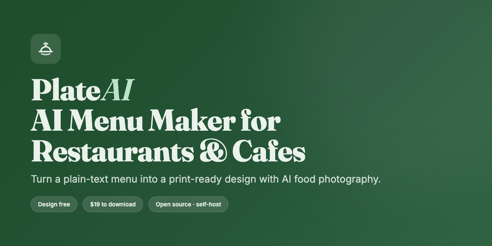
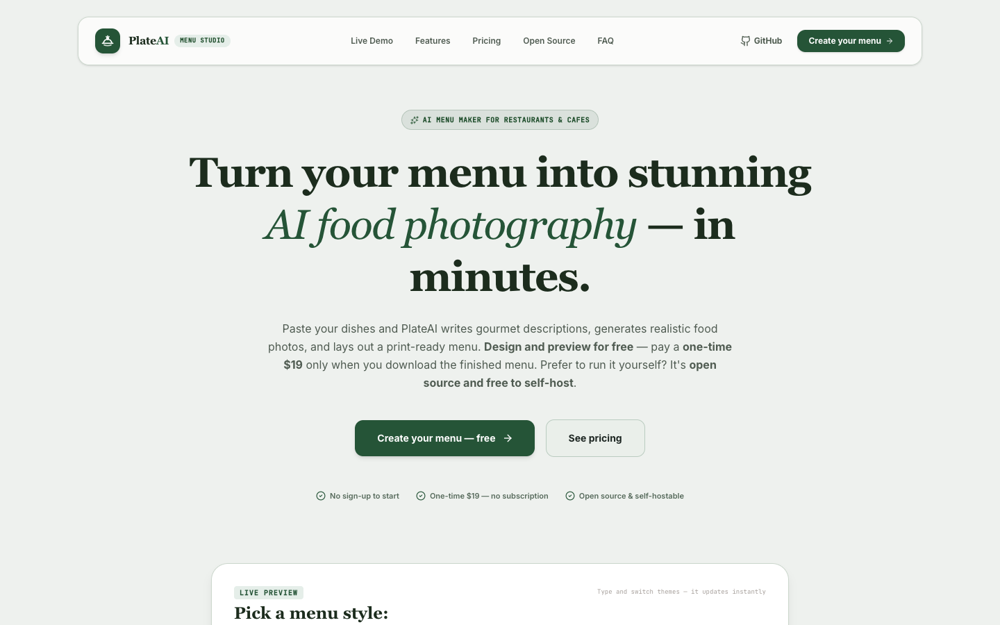
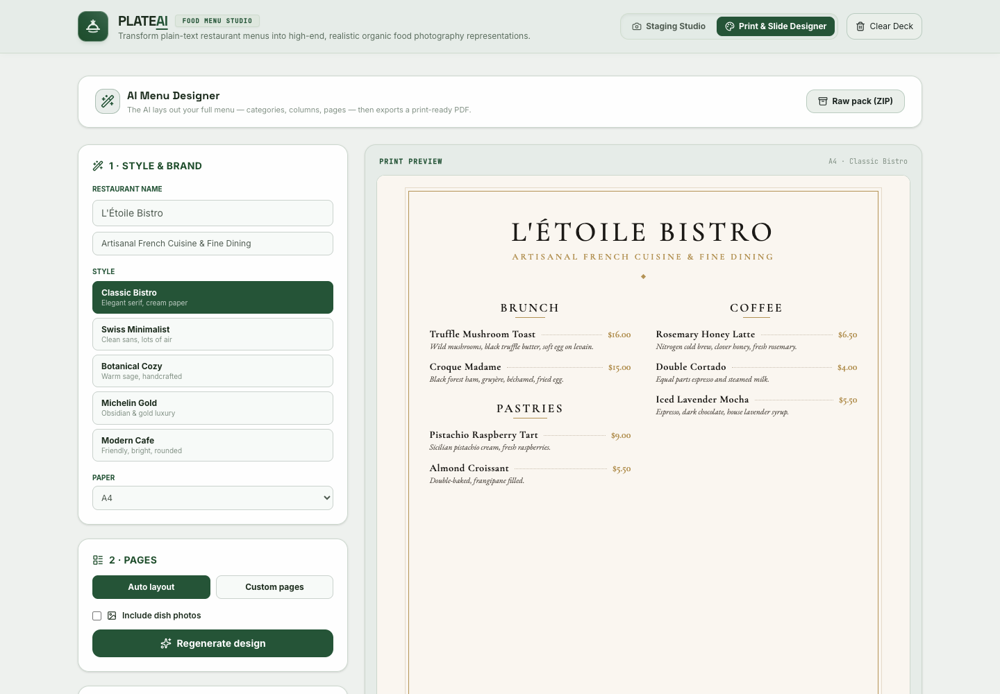
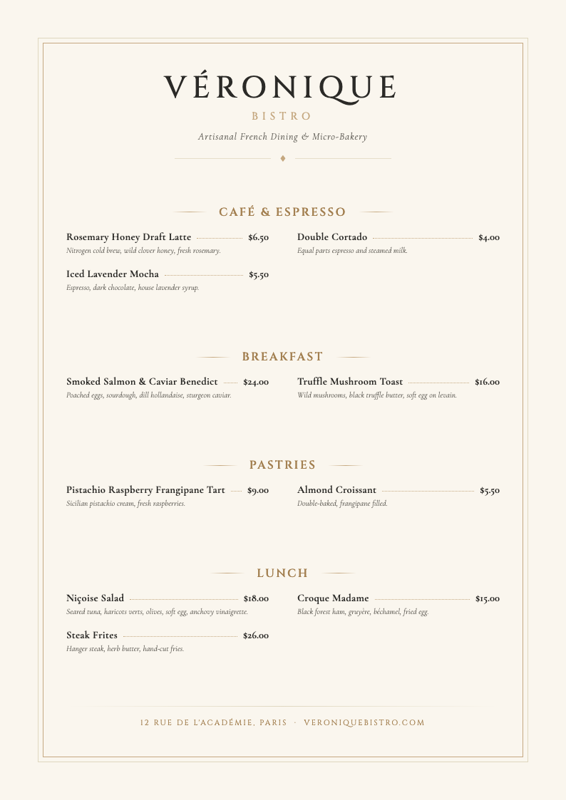

<p align="center">
  
</p>

<h1 align="center">PlateAI — AI Menu Maker for Restaurants &amp; Cafes</h1>

<p align="center">
  Turn a plain-text menu into a <b>professionally designed, print-ready menu</b> with
  <b>AI food photography</b> — in minutes. No designer, no Photoshop.
</p>

<p align="center">
  <a href="https://plateai-533944513542.us-central1.run.app"><b>🌐 Live demo</b></a> ·
  <a href="#-quick-start-self-host"><b>⚡ Self-host</b></a> ·
  <a href="#-how-it-works"><b>🧠 How it works</b></a>
</p>

<p align="center">
  
  
  
  
  
  
</p>

---

**PlateAI** is an open-source **restaurant menu maker** and **AI menu generator**. Paste your dishes
and the AI writes appetizing descriptions, generates realistic **AI food photography** for each plate,
and lays out a dense, print-ready menu — handling categories, columns and pagination automatically.
Export a **print-ready PDF**, or run the whole thing yourself for free.

Great for **restaurants, cafes, coffee shops, bars, bakeries and food trucks** that want a beautiful
menu without hiring a designer.

<p align="center">
  
</p>

## ✨ Features

- 🧠 **AI menu parser & copywriter** — structures any plain-text menu and writes gourmet descriptions.
- 📸 **AI food photography** — realistic dish photos via Google Gemini / Imagen, with style presets and prompt-based edits.
- 🎨 **AI layout engine** — the AI designs a full print-ready menu (categories, two columns, pagination) — 60 dishes fit on ~3 pages, not 25.
- 🗂️ **Page composer** — compose pages yourself: pick which sections go on each page, add a cover page, even generate an AI cover background image.
- ✍️ **Refine by sentence** — “put desserts on their own page”, “use two columns”, “make descriptions smaller”.
- 🖨️ **Print-ready PDF** — server-side rendering (real Chromium) → crisp A4 / US Letter PDF.
- 💳 **Optional paywall** — a one-time Stripe payment to download (skip it entirely when self-hosting).
- 🔓 **Open source & self-hostable** — bring your own Google Gemini key, deploy anywhere Node runs.

<p align="center">
  
  
</p>

## 🧠 How it works

1. **Parse** — paste or upload your menu as plain text; the AI extracts dishes, categories, prices and writes descriptions.
2. **Photograph** — generate realistic AI photos of each dish (optional), with style presets.
3. **Design** — the AI lays out the whole menu in a print-ready style of your choice; compose pages or let it auto-flow.
4. **Refine** — tweak it with a sentence, or edit text directly.
5. **Export** — download a print-ready PDF (A4 / US Letter) or a ZIP of images + data.

## ⚡ Quick start (self-host)

**Prerequisites:** Node.js 20+ and a free Google Gemini API key — https://aistudio.google.com/apikey

```bash
git clone https://github.com/arturayupov/PlateAI.git
cd PlateAI
npm install
cp .env.example .env.local      # then set GEMINI_API_KEY
npm run dev                      # → http://localhost:3000
```

Production:

```bash
npm run build
NODE_ENV=production node dist/server.cjs
```

> 💡 When self-hosting, the only required value is `GEMINI_API_KEY`. The Stripe paywall is optional —
> if you don't set `STRIPE_SECRET_KEY`, downloads are simply free.

### Environment variables

See [`.env.example`](.env.example). Secrets never live in the repo — keep them in `.env.local`
locally and in your host's secret manager in production.

| Variable | Required | Purpose |
|---|---|---|
| `GEMINI_API_KEY` | ✅ | Google Gemini key (text + image models) |
| `APP_URL` | for payments | Public URL for Stripe redirects |
| `STRIPE_SECRET_KEY` | optional | Enables the one-time download paywall |
| `STRIPE_PRICE_ID` | optional | The one-time price to charge |
| `ENTITLEMENT_SECRET` | optional | Signs download tokens (use a long random string) |
| `FREE_GENERATION_LIMIT` | optional | Free AI photos per visitor (default 6) |

## 🚀 Deploy

PlateAI is a standard Node server and ships with a `Dockerfile` (with Chromium for PDF rendering).
It runs on **Google Cloud Run, Render, Railway, Fly.io, or any VPS**.

**Google Cloud Run:**

```bash
gcloud run deploy plateai --source . --region us-central1 --allow-unauthenticated \
  --set-env-vars APP_URL=https://YOUR_URL,FREE_GENERATION_LIMIT=6 \
  --set-secrets GEMINI_API_KEY=GEMINI_API_KEY:latest
```

## 💳 How the paywall works (hosted mode)

No accounts, no logins. Free visitors get a limited number of **watermarked** AI photo previews
(`FREE_GENERATION_LIMIT` per IP); the clean originals stay on the server. A one-time Stripe Checkout
payment issues a short-lived, signed **entitlement token** that releases the clean, watermark-free
images and the print-ready PDF. This bounds API cost (rate limit) and prevents free clean downloads.

## 🧱 Tech stack

React 19 · TypeScript · Vite 6 · Tailwind v4 · Node/Express · Google Gemini (`@google/genai`) ·
Puppeteer (PDF) · jsPDF/JSZip (client export) · Stripe (optional).

## 🗺️ Roadmap

- [ ] “Refine in Canva” export
- [ ] More menu styles & fonts
- [ ] Multi-language menus
- [ ] QR / digital menu output

## 🤝 Contributing

Contributions are welcome! See [CONTRIBUTING.md](CONTRIBUTING.md). Please open an issue to discuss
significant changes first.

## 🔒 Security

Found a vulnerability? See [SECURITY.md](SECURITY.md). Never commit secrets — `.env*` is gitignored.

## 📄 License

[MIT](LICENSE) © Artur Ayupov

---

<sub>Keywords: restaurant menu maker, AI menu generator, AI food photography, menu design software,
menu maker, cafe menu maker, restaurant menu template, print-ready menu PDF, menu engineering,
open-source menu designer.</sub>
